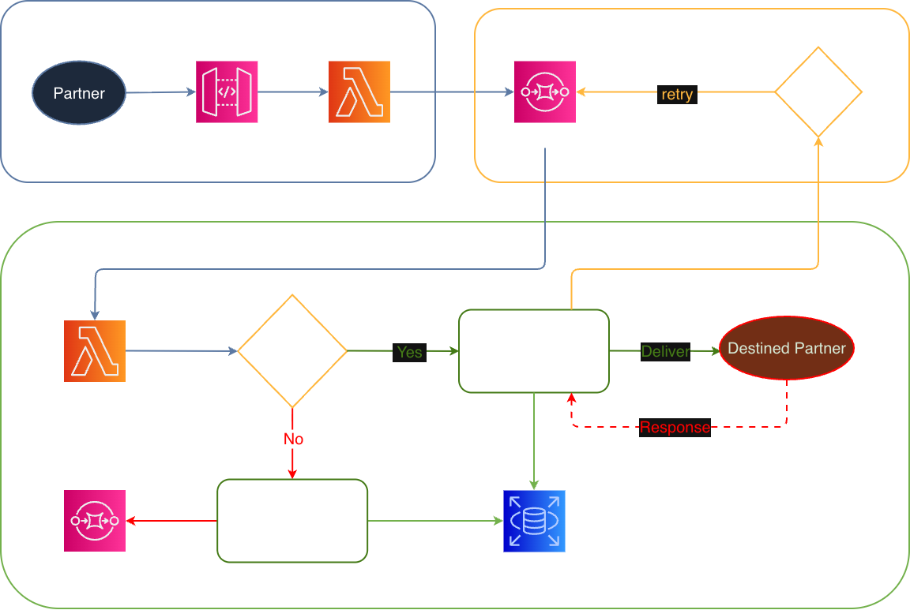

# Message Relay

Serverless message routing and delivery for partner integrations.

Message Relay is a queue-driven workflow for receiving, validating, and forwarding structured messages to downstream systems. It is designed for teams that need reliable event delivery, retry handling, and partner-specific routing without building a custom integration layer from scratch.

## Why this project matters

This project demonstrates a production-style serverless architecture built on AWS Lambda, SQS, API Gateway, and a relational database. It solves a common integration challenge: taking heterogeneous messages from upstream systems, validating them against known routing rules, and delivering them to the correct destination with retry-safe behavior.

## Core capabilities

- Receive HTTP payloads through API Gateway
- Validate incoming message metadata and routing configuration
- Move accepted messages into an SQS queue for asynchronous processing
- Dispatch to partner endpoints using configured host, path, and header metadata
- Retry failed deliveries with a queue delay strategy
- Persist successful and failed messages for troubleshooting and auditing
- Manage partner destinations through CRUD operations

## Architecture at a glance

The application follows a simple, resilient message pipeline:

1. A producer sends a JSON message to the receiver endpoint.
2. The receiver validates the request and pushes the payload to an intake queue.
3. The processor reads queued messages and validates them against partner rules.
4. Valid messages are forwarded to the configured destination endpoint.
5. Failed or rejected messages are retried or stored for investigation.
6. Partner configuration is managed through a small API and persisted in a database.

Flow diagram text:

Producer -> API Gateway -> Receiver Lambda -> SQS intake queue -> Processor Lambda -> Partner endpoint
                                             |
                                             +-> Retry queue / failure tracking / database storage

The system is intentionally modular, making it easy to extend with additional message types, validation rules, and downstream integrations.

[](./Message-Relay-Flow-Diagram.png)

## Repository layout

- [docs/](./docs): architecture and operational notes
- [src/](./src): Lambda handlers, queue processing, database access, and validation logic
- [scripts/](./scripts): operational and load-test utilities
- [localtestdata/](./localtestdata): sample events for local validation
- [localtests/](./localtests): local development and testing scripts

## Documentation

- [Directory Setup](./docs/DIRECTORYSETUP.md "Directory Setup")
- [Environment Setup](#environment-setup "Environment Setup")
- [Serverless Framework](./docs/SERVERLESS.md "Serverless Framework")
- [Lambda Functions](./docs/LAMBDA.md "Lambda Functions")
- [Queues](./docs/QUEUES.md "Queues")
- [Database](./docs/DATABASE.md "Database")
- [Partners](./docs/PARTNERS.md "Partners")
- [Messages](./docs/MESSAGES.md "Messages")
- [Pre-Prod Deploy Plan](./docs/PREPRODDEPLOYPLAN.md "Pre-Prod Deploy Plan")

## Environment setup

This project is built with Node.js, TypeScript, and Prettier. Install the required tooling before working locally.

### Node.js and npm

Download and install Node.js from the official website.

### TypeScript

```bash
npm install -g typescript
```

Watch for compiler errors while editing:

```bash
tsc --watch
# or
tsc -w
```

### Prettier

```bash
npm install --save-dev --save-exact prettier
# or globally
npm install --global prettier
```

### Environment variables

Copy the example config and update it for your local environment:

```bash
cp .env.example .env
```

### Install dependencies

```bash
npm install
```